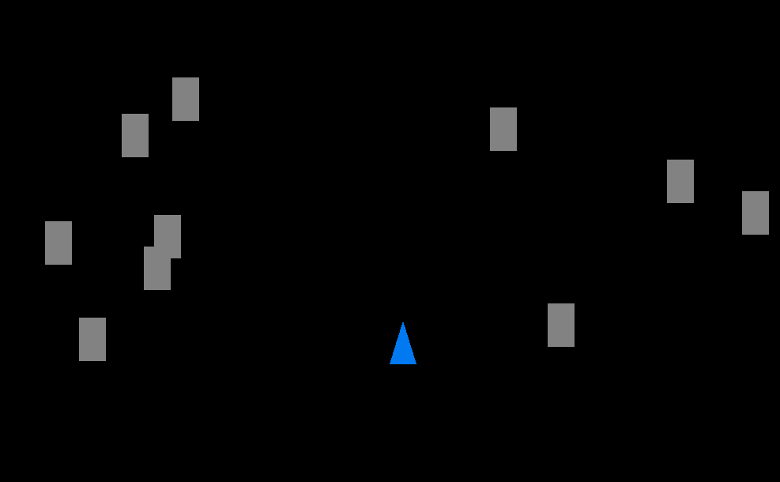
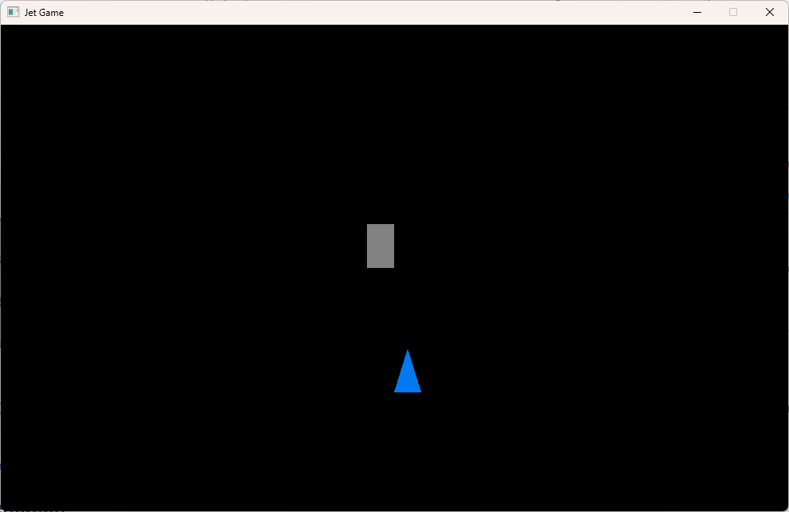

# Generating Asteroids

Our jet is lonely out in deep space. Let's throw a bunch of asteroids at it. By 
the end of this lesson, you should be able to create a window like this:



Note that our asteroids are represented by grey rectangles. Later, we will make them
prettier. Also, the asteroid won't do any damage to the jet yet. We will do that next
lesson. 

## Asteroids!

Start by adding some scaffolding code to represent Asteroids. First add a NUM_ASTEROID
macro below your other `#define` statements:

```c
// Other define statements
#define NUM_ASTEROIDS 10
```
Now add the code following code below the initial Jet code
and fill in the TODO items in the comments:

```c
typedef struct Asteroid { // defines the Asteroid struct
    Vector2 position;
    int exists;
} Asteroid;

// TODO define a `const Vector2` called ASTEROID_SIZE similar to JET_SIZE.
    // I made mine the same size as JET_SIZE, but you are welcome to use a different size.

// TODO define a `const float` called ASTEROID_SPEED similar to jet_speed.
    // I recommend being merciful by making the asteroids move slower than the jet.

Asteroid asteroids[NUM_ASTEROIDS]; // declares an array of Asteroids
```

This code (1) defines an `Asteroid` struct, (2) sets the size and speed for all
Asteroids, and (3) declares an array of Asteroids. 

While our game is running, we will populate this array with Asteroids randomly.
We will use the `exists` flag in `Asteroid` to indicate whether or not that
`Asteroid` is currently populated. Asteroids that fly off the screen
will no longer "exist" in this context. 1 means an `Asteroid` exists, 0 means it does not. 

## Initializing asteroids

Now, we need to initialize our `asteroids`. When we declared `asteroids`, we told C that
there will be an array of `NUM_ASTEROIDS` Asteroids. But we didn't tell it what the values
in that array should be. In particular, the `exists` flag for each asteroid should be 
either 1 or 0. We need to make sure that is true by setting all `exists` values to 0
before we start the game. Add this code to your `main` function after 
`SetWindowFocused();`:

```c
while (!IsWindowReady()) {} // already there
SetWindowFocused(); // already there

// make sure that no asteroids exist at game start
for (int i = 0; i < NUM_ASTEROIDS; i++) {
    asteroids[i].exists = 0;
}
```
This is a [for loop](https://www.w3schools.com/c/c_for_loop.php). It (1) sets `int i` to 0,
(2) runs until `i` is no longer less than `NUM_ASTEROIDS`, and (3) increases `i` by 1
after each iteration. 

So `i` takes the values 0, 1, 2, ..., 9 during the loop. The loop body sets `exists` to
0 (false) for each asteroid. `asteroids[0]` refers to the first asteroid because
arrays in C are "0-indexed". That means that the index 0 refers to the first element. 
So an array with 10 elements will have indexes 0, 1, 2, ..., 9. 

## Drawing One Asteroid
Now we know that none of our asteroids exist. Let's make the first asteroid,
`asteroid[0]`, exist in a specific location and draw it. 

Define a function called `maybe_generate_asteroid` like so: 

```c
void maybe_generate_asteroid() {
    if (!asteroids[0].exists) {
        asteroids[0].exists = 1;
        asteroids[0].position.x = (SCREEN_WIDTH / 2 - ASTEROID_SIZE.x);
        asteroids[0].position.y = (SCREEN_HEIGHT / 2 - ASTEROID_SIZE.y);
        return;
    }
}
```

This function currently generates the first asteroid if it doesn't exist. 
Later, we will make it generate all the asteroids in random locations.

Now call `maybe_generate_asteroid` from your render loop. Also add the code to
draw `asteroid[0]` if it exists like so:

```c
    while (!WindowShouldClose()) {
        handle_movement();
        set_jet_vertices();
        maybe_generate_asteroid(); // add this line


        BeginDrawing();
            // ... other code ...

            // add these lines // // // // // // // // // // // // // // // // // // // //
            if (asteroids[0].exists) {
                DrawRectangleV(asteroids[0].position, ASTEROID_SIZE, GRAY);
            }
            // // // // // // // // // // // // // // // // // // // // // // // // // //

        EndDrawing();
    }

```

This should give you a window that has a stationary asteroid and a movable jet.



## Moving Asteroids
Now, if it exists, we want to move the asteroid downward towards our fearless pilot. 
When it reaches the end of the screen, we want to cause it to no longer exists. 
That way, we can generate it again and continue endangering our hero. 

Define a function called `step_asteroids` like so and fill in the code for 
the TODO items.

```c
void step_asteroids() {
    if (asteroids[0].exists) {
        // TODO increase asteroids[0]'s y position by ASTEROID_SPEED.
        if (asteroids[0].position.y > SCREEN_HEIGHT) {
            // TODO make asteroids[0] no longer exist.
        }
    }
}
```

Once you've done the TODO items, call `step_asteroids` below `maybe_generate_asteroid`.

```c
    // ... other code ...
    maybe_generate_asteroid(); 
    step_asteroids();
    // ... other code ...
```

Now you should see the asteroid moving down off the screen and immediately reappearing 
continuiously. 

## Randomly Generating One Asteroid
TODO

## Generating All Asteroids
TODO
